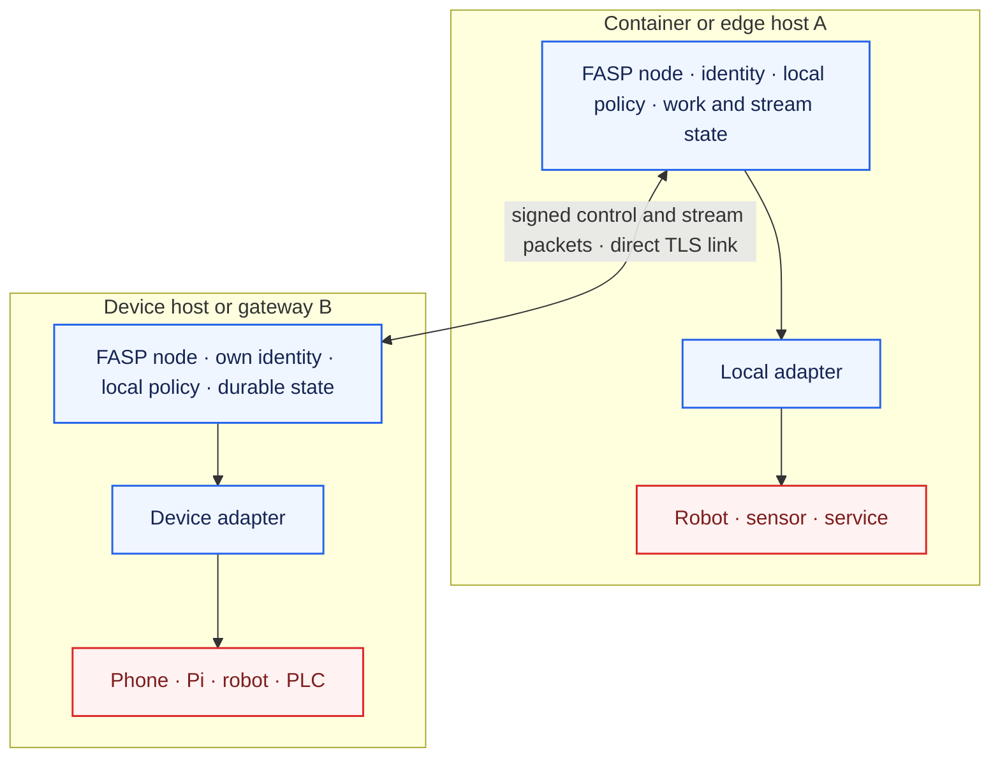
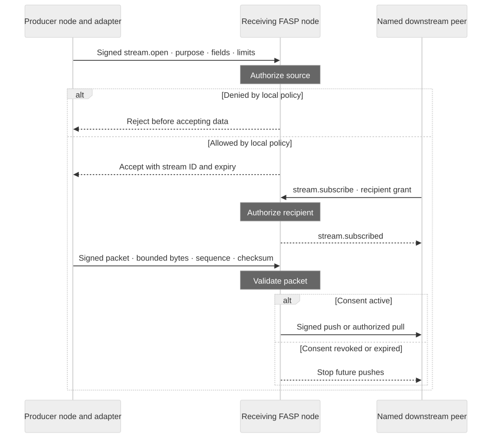
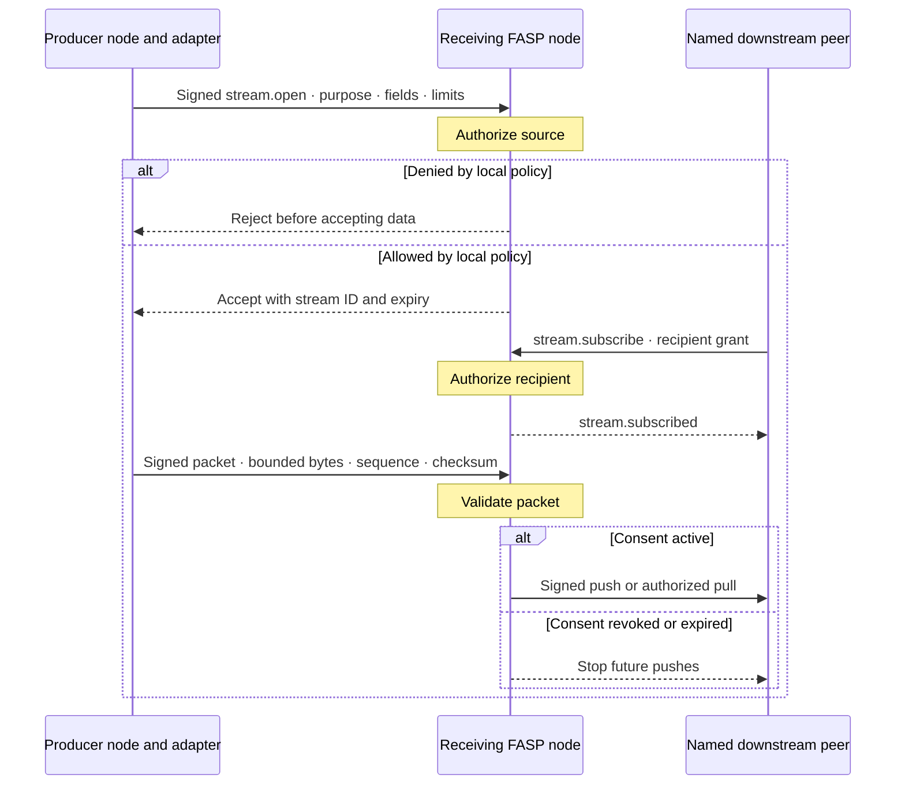

# FASP architecture

FASP is a node-first framework for coordinating agents and devices across
processes, containers, edge hosts, and networks. A node owns one stable
identity, local authorization policy, durable work state, and the adapters it
is allowed to call. Nodes communicate directly over the signed FASP HTTP and
WebSocket transports implemented here.

The design takes infrastructure ideas from Google's
[`agentmesh`](https://github.com/google/agentmesh): keep node, control, and
networking roles small; place enforcement at each node; and add routing only
when deployment topology needs it. Agent Mesh's
[architecture](https://google.github.io/agentmesh/docs/concepts/architecture/),
[identity model](https://google.github.io/agentmesh/docs/concepts/identity/),
[authorization model](https://google.github.io/agentmesh/docs/concepts/authorization/),
[networking](https://google.github.io/agentmesh/docs/concepts/networking/), and
[control/data boundaries](https://google.github.io/agentmesh/docs/concepts/boundaries/)
are useful references, not dependencies or a protocol to copy. FASP keeps its
own Python implementation, signed-envelope protocol, and device safety model.



## Reference topology



Each node also exposes local operator controls for pairing, grants, revocation,
and configuration. The diagram omits these controls from the peer data path.
A future router for unreachable peers is described below; it is not part of
the current runtime.

The node is the trust boundary, not the container. A container is one useful
way to package a node; a host process or a device gateway can run the same
package. Give every independently trusted node its own identity and persistent
state directory. Never bake a private identity key into an image or copy one
node's state volume to another.

The operator manages each node's local pairing, grants, revocation, and
configuration. Those controls are not a centralized proxy for every request:
the receiving node authenticates the peer and applies its own current policy
before a handler or adapter runs. The local controller and device safety
functions retain final authority over physical behavior. A future issuer may
help enroll nodes and distribute policy, but it cannot override a node's local
deny decision.

## One work model

Every executable request uses one durable lifecycle:

```text
queued → running → succeeded | failed | cancelled
```

Intent work and fleet missions share identity, idempotency, state transitions,
and recovery in `work_items`. Their payload and domain-specific progress remain
separate: a mission's `phase` can be `preflight`, `assigned`, or `paused`
without inventing another lifecycle. Public FASP task and mission responses
keep compatibility projections for their existing clients. See
[`WORK_ITEMS.md`](WORK_ITEMS.md) for state mapping and migration details.

## Selective streaming and data sharing



The receiving node accepts a stream only when all of these checks agree:



1. The sender is a paired peer with a capability scope that covers the exact
   stream capability.
2. The grant is valid for that peer, capability, and stated purpose when a
   grant is required.
3. The node's local `stream_sharing` rule names that peer and allows the
   requested purpose, fields, media type, delivery mode, rate, duration,
   packet size, window, retention, and forwarding recipients.
4. The stream lease is live and each packet stays within the accepted size,
   sequence, rate, and checksum bounds. JSON records also pass the field
   allowlist before they are stored or forwarded.

An empty `stream_sharing` list denies remote streams. Forwarding is off unless
the local rule and the stream contract both name the exact downstream peer;
that peer must also be paired, authorized, and present a recipient grant.
The forwarding node stores the consent reference and rechecks peer state,
capability, current sharing policy, grant expiry, and revocation before every
live push. A stale subscription is removed without blocking the producer's
packet. A forwarded event is signed by the forwarding node. Revocation stops
future delivery; it cannot recall data already delivered.
`reliable` streams use sequence and credit-window checks; `latest` is for
replaceable samples. Both use bounded packet sizes and retention, and every
stream has an explicit expiry.

For `application/json`, every packet must be one complete UTF-8 object, with no
duplicate keys or non-finite numbers. The receiver rejects top-level keys
outside the contract's `fields` allowlist before storing or forwarding the
packet. This simple profile is for small structured records; larger objects
need a schema-aware adapter. The core does not recursively filter nested JSON
values and cannot infer fields inside image, audio, or other binary data. An
adapter must validate nested structures and serialize only approved binary
content. A `fields` declaration alone is never proof that opaque bytes were
inspected or redacted.

Configure stream rules in the node's JSON file. The example intentionally
starts with no remote sharing:

```json
{
  "stream_sharing": []
}
```

An operator can opt in a paired sender and keep forwarding disabled like this:

```json
{
  "stream_sharing": [
    {
      "capability": "observe.environment.temperature.v1",
      "peer_ids": ["fasp:system:replace-with-paired-peer-id"],
      "purposes": ["room-temperature-dashboard"],
      "fields": ["temperature_c"],
      "content_types": ["application/json"],
      "delivery_modes": ["reliable", "latest"],
      "max_rate_hz": 2,
      "max_duration_s": 300,
      "max_payload_bytes": 40960,
      "max_window": 32,
      "max_retention_packets": 32,
      "forward_to": [],
      "require_grant": true
    }
  ]
}
```

Each rule uses exact peer IDs, capability, purposes, fields, content types,
delivery modes, limits, and `forward_to` entries. Stream grants can add
narrower field, rate, duration, delivery, payload, window, retention, and
recipient constraints. See
[`examples/node.json`](examples/node.json) and
[`FASP_MESSAGING_STREAMING.md`](FASP_MESSAGING_STREAMING.md) for the stream
contract and transport behavior.

## Containers, devices, and transports

The same Python package runs as a process or in the included Docker image. A
deployment supplies its network endpoint, TLS material, persistent state
volume, and local adapter configuration. For example, the Docker image exposes
the HTTP/WebSocket listener and stores identity, SQLite state, and artifacts
under `/home/fasp/.fasp`; each container should receive its own persistent
volume. A device that cannot run this Python package can connect through a
FASP gateway on its local host. Keep hardware drivers beside the hardware and
keep safety interlocks local.

The implemented network transports are signed HTTP envelopes, a WebSocket
channel, an outbound HTTPS relay mailbox, Bluetooth Classic RFCOMM, and BLE L2CAP credit based channels carrying
the same envelope protocol. The Bluetooth bearers are opt-in Linux listeners;
BLE L2CAP requires Python 3.14 or newer. TLS 1.3 protects routable IP links;
mTLS is available for an additional transport identity check. Bluetooth
listeners require authenticated, encrypted BlueZ links and still
use the same FASP signature, pairing, and policy checks. See
[`CONNECTIVITY.md`](CONNECTIVITY.md) for radio and Wi-Fi setup and
[`COMMUNICATION_CATALOG.md`](COMMUNICATION_CATALOG.md) for the canonical
packet, stream, and optional artifact path across other communication sources.
The direct signed JSON envelope is not end-to-end encrypted; a terminating
reverse proxy can read it. The relay transport wraps the same signed envelope
in recipient-key encryption, so relay hubs only see routing metadata.

MQTT, DDS, QUIC, serial/CBOR, remote identity issuance, automatic enrollment,
and dynamic route discovery are extension points or protocol profiles, not
implemented runtime transports. The opt-in relay uses pinned X25519 keys
from signed ID cards, ephemeral key agreement, and authenticated encryption.
Its routing is configured explicitly and capped at four hubs. The included
`resilience/mesh.py` remains a network simulator; `fasp drain --watch` is
the live durable sender worker.

## Configuration and packaging

Use the same deployable unit across environments and change the node's local
configuration, state directory, network exposure, and adapters per deployment.
`NodeConfig.from_file()` rejects unknown keys so a misspelled safety or sharing
setting cannot silently fall back to a default. Server flags configure the
listener and TLS; `examples/node.json` configures device integrations, local
policy, and stream sharing. The reference image is built from `Dockerfile`;
installing the Python package directly is also supported.

Keep identity keys and admin tokens in the node's protected state directory,
with filesystem permissions and disk encryption supplied by the host. For a
container, mount persistent storage and inject TLS files through the runtime's
secret mechanism. Do not include state, credentials, or device keys in an
image, source tree, or shared volume.

## Current implementation and next boundaries

| Boundary | Implemented here | Add separately when needed |
|---|---|---|
| Node identity | Per-node Ed25519 identity and signed profile | Offline-verifiable short-lived credentials from a shared issuer |
| Trust | Explicit pairing, local capability scopes, expiring grants, revocation | Organization-wide enrollment and policy distribution |
| Work | One durable SQLite work-item lifecycle for intents and missions | Replicated coordination store if active-active state is required |
| Data | HTTP packet baseline, WebSocket live push, bounded retention and local stream rules | QUIC, MQTT/DDS bridge, serial profile, media transport |
| Routing | Direct peer link | Store-and-forward router for unreachable peers, with a reviewed encryption design |
| Runtime | Python package and Docker image; adapters run beside node | Native constrained-device runtime if a device cannot use a gateway |
| Safety | Local adapter gates and separate safety-controller integrations | Device-specific certification and physical conformance evidence |

Do not split modules into services just because they have different names. Run
one node per trust boundary first, then separate the control function or add a
router only to meet an operational ownership or reachability requirement. A
SQLite file copied between hosts is not replicated high availability.

## Google Agent Mesh references

The design uses Google's Agent Mesh as an infrastructure reference for node
identity, default-deny access, node-local enforcement, direct links with relay
fallback, and deployment shapes. Its separation of control plane, router, and
node is a useful scaling boundary; FASP keeps a single-node default and adds
those services only when deployment requires them. This repository does not
claim protocol compatibility or reuse Agent Mesh code.

- [Agent Mesh repository and project status](https://github.com/google/agentmesh)
- [Architecture](https://google.github.io/agentmesh/docs/concepts/architecture/)
- [Identity and enrollment](https://google.github.io/agentmesh/docs/concepts/identity/)
- [Authorization](https://google.github.io/agentmesh/docs/concepts/authorization/)
- [Networking](https://google.github.io/agentmesh/docs/concepts/networking/)
- [Control/data boundaries](https://google.github.io/agentmesh/docs/concepts/boundaries/)
- [Scalability and deployment](https://google.github.io/agentmesh/docs/guides/scalability/)

## Interoperability and adjacent infrastructure

FASP's useful distinction is its combination of edge coordination, local
physical-safety boundaries, uncertainty-carrying spatial state, and a stream
contract that can stop forwarding when a recipient's consent changes. These
are implemented capabilities, not a claim of benchmark superiority. Keep the
core small and use adapters for adjacent standards:

- [A2A](https://a2a-protocol.org/latest/) standardizes agent task exchange and
  streaming. An interoperability adapter can map FASP `work_items` to A2A
  tasks while keeping one internal lifecycle; FASP is not A2A wire-compatible.
- [AGNTCY](https://docs.agntcy.org/) separates discovery, identity, schemas,
  messaging, and observability. Those are sensible integration boundaries;
  FASP does not need to reimplement every component in that stack.
- [AGNTCY SLIM](https://github.com/agntcy/slim) shows a messaging layer with
  separate data-plane, session, and control-plane responsibilities, including
  end-to-end group encryption. FASP's current signed JSON transport does not
  provide end-to-end encryption.
- [NATS leaf nodes](https://docs.nats.io/learn/topologies/leaf-nodes) show how
  an edge site behind a firewall can establish an outbound-only connection to
  a hub. FASP's HTTPS relay similarly lets NATed nodes poll outward.

Protocol bridges, remote enrollment, federated discovery, dynamic relay
routing, and nested structured-data validation remain separate extensions.
They should be added only with an interoperability test and a clear owner for
identity, policy, and failure recovery.
